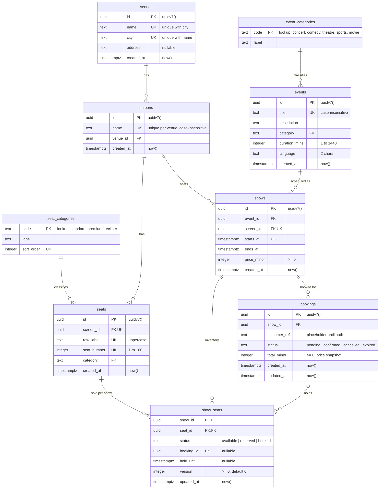

# Entity relationship diagram

Built from `prisma/schema.prisma` and the SQL in `prisma/migrations/`. The migrations are the source of truth: CHECK, EXCLUDE and expression indexes live only there.

## Diagram

## Foreign keys

All foreign keys are `ON UPDATE NO ACTION`.

| Constraint                   | From                    | To                      | On delete |
| ---------------------------- | ----------------------- | ----------------------- | --------- |
| `screens_venue_id_fkey`      | `screens.venue_id`      | `venues.id`             | RESTRICT  |
| `seats_screen_id_fkey`       | `seats.screen_id`       | `screens.id`            | CASCADE   |
| `seats_category_fkey`        | `seats.category`        | `seat_categories.code`  | RESTRICT  |
| `events_category_fkey`       | `events.category`       | `event_categories.code` | RESTRICT  |
| `shows_event_id_fkey`        | `shows.event_id`        | `events.id`             | RESTRICT  |
| `shows_screen_id_fkey`       | `shows.screen_id`       | `screens.id`            | RESTRICT  |
| `show_seats_show_id_fkey`    | `show_seats.show_id`    | `shows.id`              | CASCADE   |
| `show_seats_seat_id_fkey`    | `show_seats.seat_id`    | `seats.id`              | RESTRICT  |
| `show_seats_booking_id_fkey` | `show_seats.booking_id` | `bookings.id`           | RESTRICT  |
| `bookings_show_id_fkey`      | `bookings.show_id`      | `shows.id`              | RESTRICT  |

Delete paths that follow from these:

- A show with bookings can't be deleted (`bookings_show_id_fkey`). A show without bookings takes its `show_seats` rows with it.
- A seat that has `show_seats` rows can't be deleted, so a screen whose seats are used by a show can't be deleted either.
- Bookings are never deleted, only moved to `cancelled` or `expired`.

## Unique constraints and indexes

| Name                                        | Table             | Columns                               | Note                       |
| ------------------------------------------- | ----------------- | ------------------------------------- | -------------------------- |
| `venues_name_city_key`                      | `venues`          | `(name, city)`                        |                            |
| `screens_venue_id_name_lower_key`           | `screens`         | `(venue_id, lower(name))`             | Expression index, SQL only |
| `seat_categories_sort_order_key`            | `seat_categories` | `(sort_order)`                        |                            |
| `seats_screen_id_row_label_seat_number_key` | `seats`           | `(screen_id, row_label, seat_number)` |                            |
| `events_title_lower_key`                    | `events`          | `(lower(title))`                      | Expression index, SQL only |
| `shows_screen_id_starts_at_key`             | `shows`           | `(screen_id, starts_at)`              |                            |
| `show_seats_pkey`                           | `show_seats`      | `(show_id, seat_id)`                  | Composite primary key      |

## Exclusion constraint

| Name               | Table   | Rule                                                                           |
| ------------------ | ------- | ------------------------------------------------------------------------------ |
| `shows_no_overlap` | `shows` | `EXCLUDE USING gist (screen_id WITH =, tstzrange(starts_at, ends_at) WITH &&)` |

No two shows on the same screen may overlap in time. Needs the `btree_gist` extension. Violations raise `23P01`.

## CHECK constraints

| Name                                            | Table             | Rule                                                         |
| ----------------------------------------------- | ----------------- | ------------------------------------------------------------ |
| `venues_name_length_check`                      | `venues`          | `char_length(trim(name))` 1 to 100                           |
| `venues_city_length_check`                      | `venues`          | `char_length(trim(city))` 1 to 100                           |
| `venues_address_length_check`                   | `venues`          | `char_length(trim(address))` 1 to 500                        |
| `screens_name_length_check`                     | `screens`         | `char_length(trim(name))` 1 to 100                           |
| `seat_categories_sort_order_non_negative_check` | `seat_categories` | `sort_order >= 0`                                            |
| `seats_row_label_not_empty_check`               | `seats`           | `char_length(trim(row_label)) > 0`                           |
| `seats_row_label_uppercase_check`               | `seats`           | `row_label = upper(row_label)`                               |
| `seats_seat_number_range_check`                 | `seats`           | `seat_number` 1 to 100                                       |
| `events_title_length_check`                     | `events`          | `char_length(trim(title))` 1 to 100                          |
| `events_description_length_check`               | `events`          | `char_length(trim(description))` 20 to 2000                  |
| `events_duration_mins_range_check`              | `events`          | `duration_mins` 1 to 1440                                    |
| `events_language_length_check`                  | `events`          | `char_length(trim(language)) = 2`                            |
| `shows_price_minor_non_negative_check`          | `shows`           | `price_minor >= 0`                                           |
| `show_seats_status_check`                       | `show_seats`      | `status IN ('available', 'reserved', 'booked')`              |
| `show_seats_version_non_negative_check`         | `show_seats`      | `version >= 0`                                               |
| `show_seats_state_check`                        | `show_seats`      | See the state table below                                    |
| `bookings_status_check`                         | `bookings`        | `status IN ('pending', 'confirmed', 'cancelled', 'expired')` |
| `bookings_total_minor_non_negative_check`       | `bookings`        | `total_minor >= 0`                                           |

### `show_seats_state_check`

Each seat status allows exactly one shape of `booking_id` and `held_until`:

| `status`    | `booking_id` | `held_until` |
| ----------- | ------------ | ------------ |
| `available` | NULL         | NULL         |
| `reserved`  | NOT NULL     | NOT NULL     |
| `booked`    | NOT NULL     | NULL         |

## Lookup rows

Seeded in `0_init`, not modelled by Prisma:

- `seat_categories`: `standard` (0), `premium` (1), `recliner` (2).
- `event_categories`: `concert`, `comedy`, `theatre`, `sports`, `movie`.
